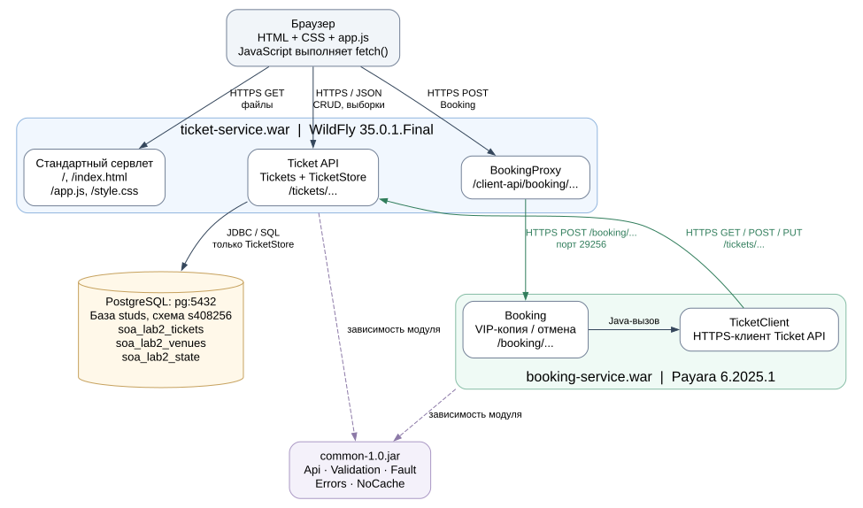
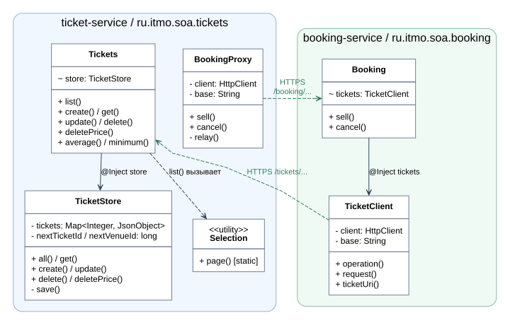

# Модули и классы Ticket / Booking

Диаграммы описывают реализацию после удаления `ClientPage`. Первая показывает
границы модулей и сетевые вызовы, вторая - основные Java-классы внутри сервисов.
Названия и связи проверены по исходному коду; `Ticket`, `Venue` и `Coordinates`
здесь являются JSON-объектами, отдельных Java-классов с такими именами нет.

[Обе диаграммы с пояснениями в PDF](architecture.pdf) можно приложить к отчёту
или открыть отдельно на защите.

## Взаимодействие модулей



Сплошные стрелки показывают направление запросов или вызовов. Ответ возвращается
обратно по тому же соединению. Пунктир к `common` обозначает зависимость сборки:
библиотека включена в оба WAR, собственного процесса и сетевого API у неё нет.

1. WildFly отдаёт `index.html`, `app.js` и `style.css` стандартным сервлетом.
   После загрузки `app.js` выполняется в браузере. Стартовая страница настроена
   через `WEB-INF/web.xml`; Java-класс `ClientPage` больше не требуется.
2. Для таблицы, фильтров и CRUD браузер вызывает `/tickets/...`. Обработчик
   `Tickets` использует `TicketStore`; `Selection` фильтрует, сортирует и разбивает
   на страницы снимок коллекции в памяти.
3. Для VIP-продажи и отмены браузер вызывает `/client-api/booking/...` на том же
   адресе WildFly. `BookingProxy` передаёт запрос в Payara по HTTPS, сохраняет
   HTTP-статус и тело ответа. Бизнес-логику выполняет `Booking`.
4. `Booking` использует `TicketClient`, который вызывает Ticket API по HTTPS.
   Доступа к `TicketStore` как Java-объекту и подключения к PostgreSQL у Booking нет.
5. Только `TicketStore` читает и записывает БД через JDBC. При инициализации он
   загружает коллекцию; после изменения обновляет память только после COMMIT.
   Билет, площадка и счётчики ID сохраняются в одной транзакции.

На Helios публичный вход Ticket находится на порту 28256. Перед WildFly стоит
nginx: TLS передаётся на `127.0.0.1:28257`, обычный HTTP получает редирект 308.
TLS завершается в WildFly. На схеме эта транспортная прослойка опущена.
Payara принимает HTTPS на порту 29256. Оба межсервисных клиента проверяют
сертификат и имя узла. Через SSH-туннель приложение по-прежнему использует HTTPS.

## Основные классы



Поля и методы показаны выборочно; параметры и возвращаемые типы методов опущены.
`+` - public, `-` - private, `~` - package-private. Сплошная стрелка с `@Inject`
показывает ссылку на объект, которую передаёт CDI. Пунктир показывает зависимость;
зелёные стрелки - HTTPS-вызовы между двумя приложениями, а не Java-ссылки.

`TicketApplication`, `ClientApiApplication` и `BookingApplication` наследуют
`jakarta.ws.rs.core.Application`. Они задают маршрутизацию и регистрируют ресурсы
и `Errors`. Это конфигурация JAX-RS, а не три дополнительных сервиса.

| Класс в `common` | Ответственность и связи |
|---|---|
| `Api` | Разбор и формирование JSON, проверка параметров, даты; используется обоими сервисами и `Errors`. |
| `Validation` | `ticket()` проверяет тело билета перед записью; `Selection` использует наборы допустимых типов, `Booking` - `violation()` для ошибки удвоения цены. |
| `Fault` | Наследует `RuntimeException`, хранит HTTP-статус и нарушения ограничений. Прикладные классы выбрасывают его, `Errors` преобразует в ответ. |
| `Errors` | Реализует `ExceptionMapper<Exception>`: формирует JSON-ответ об ошибке через `Api`. Зарегистрирован во всех трёх JAX-RS Application. |
| `NoCache` | Реализует Servlet `Filter`; `@WebFilter("/*")` добавляет `Cache-Control: no-store` к статике и API в обоих WAR. |

## Как проходит запрос

**Загрузка таблицы:** `app.js` → HTTPS `GET /tickets` → `Tickets.list()` →
`TicketStore.all()` → `Selection.page()` → JSON → отображение в браузере.
Здесь чтение идёт из памяти `TicketStore`, а не отдельным SQL-запросом на каждую страницу.

**Продажа VIP-копии:** `app.js` → `BookingProxy.sell()` → HTTPS → `Booking.sell()`
→ `TicketClient.operation(GET)` → Ticket API. Затем `Booking` копирует изменяемые
поля, удваивает цену, задаёт VIP и `personId`; `TicketClient.operation(POST)`
создаёт копию через Ticket API. `Tickets.create()` проверяет данные, `TicketStore`
назначает ID и дату и сохраняет копию в БД. Исходный билет не изменяется.

**Отмена бронирований:** `Booking.cancel()` сначала получает все страницы билетов
человека через `TicketClient`, затем вызывает `PUT /tickets/{id}` для каждого
билета с `personId = null`. Это последовательность отдельных запросов, общей
распределённой транзакции нет.

## Короткое объяснение для защиты

«У нас два самостоятельных веб-сервиса и общая библиотека. Клиент размещён
в WAR первого сервиса, а JavaScript выполняется в браузере. Ticket Service
управляет коллекцией и единственный обращается к PostgreSQL. Booking Service
реализует операции бронирования через REST первого сервиса. Прокси в WildFly
позволяет браузеру обращаться к обоим сервисам через один адрес. Общие проверки,
формат JSON, обработка ошибок и запрет кэширования вынесены в `common`».

## Исходники диаграмм

Редактируемые исходники: [components.dot](diagrams/components.dot) и
[classes.dot](diagrams/classes.dot). SVG можно вставить в отчёт без потери качества.
Для повторного построения достаточно Graphviz; приложение при этом не меняется:

```sh
dot -Tsvg docs/diagrams/components.dot -o docs/diagrams/components.svg
dot -Tsvg docs/diagrams/classes.dot -o docs/diagrams/classes.svg
```
